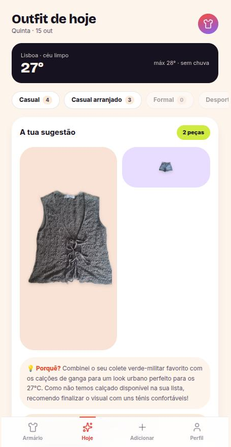
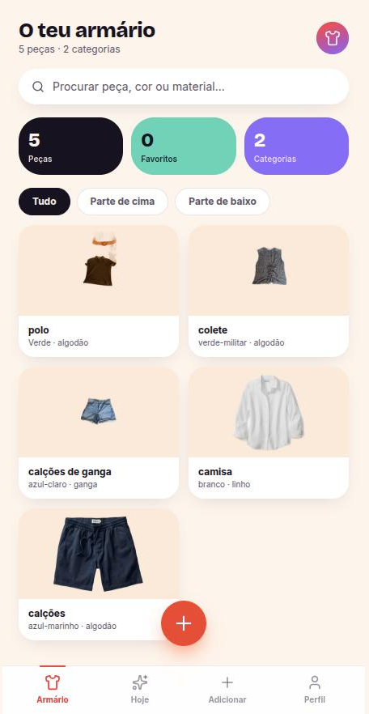
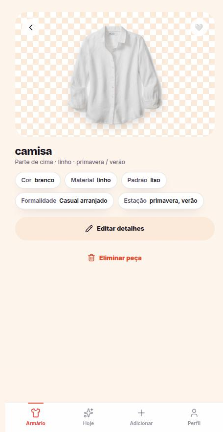
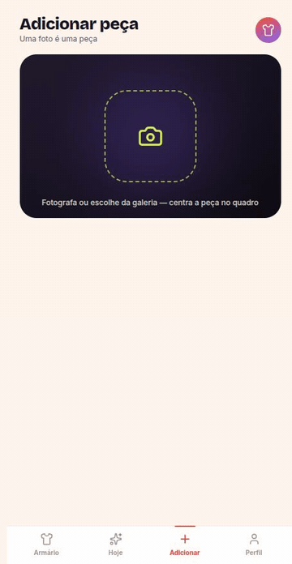
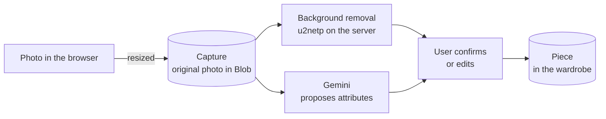

# Outfits

A mobile-first web app that tells you what to wear today using the clothes you already own, and shows you what is missing to reach the looks you like.

You take a photo of a piece of clothing, the server cuts out the background and an AI vision model proposes its attributes. Once your wardrobe has a few pieces, the app suggests outfits for the day based on the real weather where you live, and learns from your 👍 and 👎.

**Live demo:** https://outfits-gamma.vercel.app

<table>
  <tr>
    <td align="center"><br><sub>Dress me today</sub></td>
    <td align="center"><br><sub>Wardrobe</sub></td>
    <td align="center"><br><sub>Piece and its attributes</sub></td>
    <td align="center"><br><sub>What you're missing</sub></td>
  </tr>
</table>

## What it does

- **Add a piece from a photo.** The photo is resized in the browser and stored as a *Capture*. On the server, the background is removed and Gemini proposes the attributes (category, colours, pattern, formality, seasons, material). You confirm or edit them and the Capture becomes a piece in your wardrobe.
- **Wardrobe.** A grid of your pieces with favourites, a detail page to edit attributes and inline confirmation to delete.
- **Dress me today.** Outfit suggestions built only from pieces you own, using live weather from Open-Meteo for your district and the formality you need. Your feedback on each suggestion feeds the next ones.
- **What you're missing.** Upload an inspiration image of a look you like and the app tells you which pieces you already have and which ones you would need to buy.
- **Profile and onboarding.** Gender, district and style preferences saved on first login.

## Adding a piece, recorded on the live demo

<p align="center">
  
</p>

A real photo of a denim vest on a hanger. The cutout took 2.1 s and the recognition 5.1 s, and you can see the hanger was only partly removed. There is also an [MP4 version](docs/screenshots/add-piece.mp4).

## How a photo becomes a piece



## The interesting part: background removal in a serverless function

The first plan was to use a managed API per photo. When the requirement became zero cost per photo, I switched to running **u2netp** (U²-Net portable, Apache-2.0, 4.5 MB) with `onnxruntime-node` inside the app itself, in `lib/images/cutout.ts`.

Getting a native runtime to work inside a Vercel Function was the hard part. The function bundle did not include `libonnxruntime.so`, `sharp` loads `libvips` at runtime through `dlopen`, and pnpm's chained symlinks broke the file tracing. Each one is fixed in its own commit.

Measured on a real photo (873×763):

| | |
|---|---|
| Session load (cold start) | 65 to 95 ms |
| CPU inference | 165 ms |
| Total per photo | ~256 ms |
| Cost per photo | 0 |

The reasoning, the numbers and the caveats are in [ADR-0004](./docs/adr/0004-recorte-com-u2netp-auto-hospedado.md), which reverses part of [ADR-0001](./docs/adr/0001-recorte-de-fundo-no-servidor.md). It also explains why I avoided `@imgly/background-removal`, which is AGPL.

## Tech stack

- **Next.js** (App Router, Server Components, Server Actions) as a PWA
- **TypeScript**, **Tailwind CSS**, **shadcn/ui** and **Motion**
- **Gemini** through the **Vercel AI SDK**, with structured output validated by **Zod**. The AI lives in an isolated layer (`lib/ai`) so the provider can be swapped.
- **Postgres** on **Neon** with **Drizzle** ORM and migrations
- **Auth.js** with Google sign-in (email magic link via Resend behind the `AUTH_EMAIL_LOGIN` flag)
- **Vercel Blob** for images, **Open-Meteo** for weather
- **onnxruntime-node** and **sharp** for the cutout

## Documentation

The product and technical docs are written in Portuguese.

- [`PRD.md`](./PRD.md) is the product vision and scope.
- [`CONTEXT.md`](./CONTEXT.md) is the domain glossary (Peça, Captura, Recorte, Armário…), the language the code uses.
- [`docs/adr/`](./docs/adr/) records the architecture decisions and where they changed.
- [`ARCHITECTURE.md`](./ARCHITECTURE.md) is the original technical plan. When it and an ADR disagree, the ADR wins.

## Running it locally

```bash
pnpm install
cp .env.example .env.local   # fill in the values, each one is explained in the file
pnpm db:migrate
pnpm dev
```

Then open http://localhost:3000.

## Status

This is a personal project and it is still evolving.

- The screenshots are from the live demo with my own wardrobe.
- Generating an outfit sometimes takes long enough for the AI call to time out. Trying again usually works, and a better loading and retry flow is on the list.
- The cutout was measured on product-style photos. Harder phone photos in messy rooms have not been tested yet.

## Author

António Santos · [antonio2antos.vercel.app](https://antonio2antos.vercel.app)
